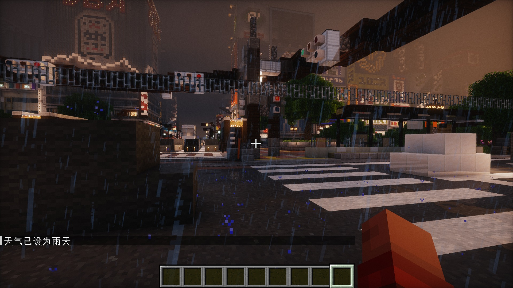
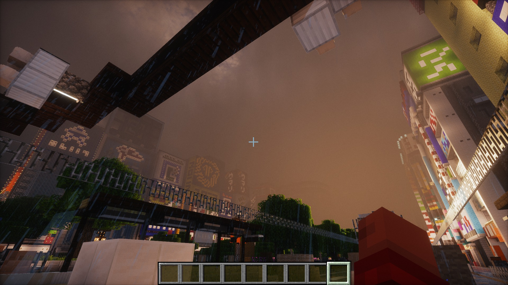
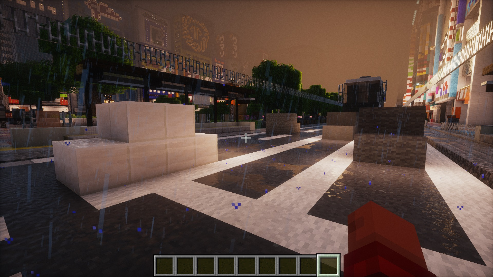
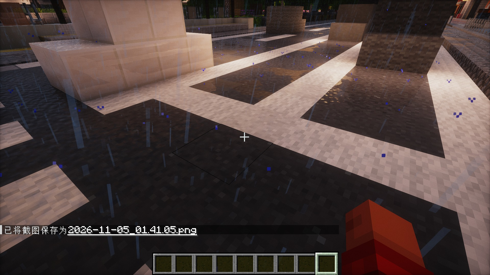
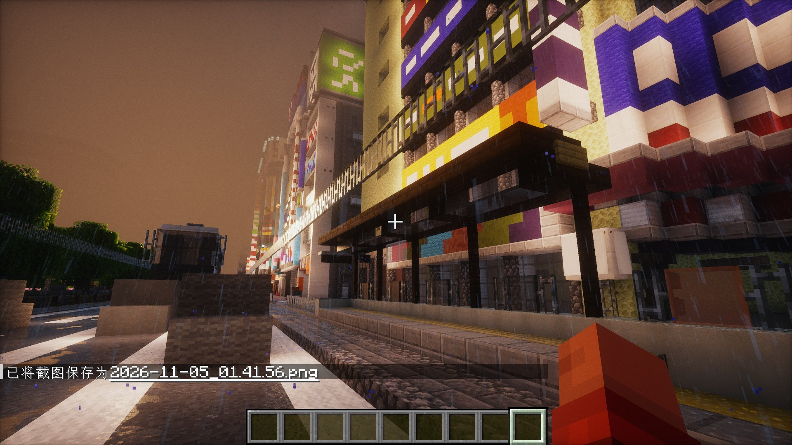
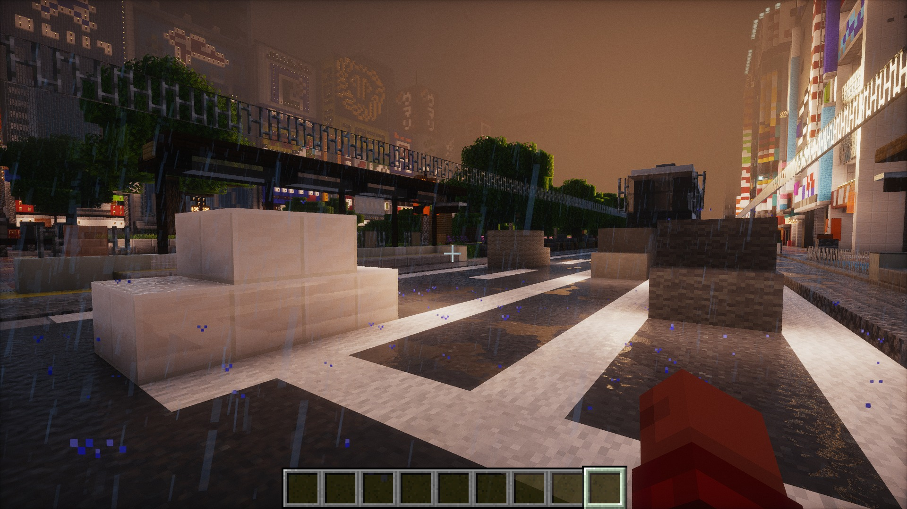

# Zephyr — Minecraft 电影感光影

> 目标：把 MC 画面做成一整套「雨夜湿地面 + 黄昏逆光 + 动漫写实混合」的电影感。
> 参考基准：用户截图中的异环/光追画面；舒适度基准：`ComplementaryReimagined_r5.7.1 + EuphoriaPatches_1.8.6`。
> 当前版本：**v0.3（Rain shape & surface）**：电影感调色 + 天气自适应 + 重塑的雨丝与雨水表面反应。

---

## 1. 现在有什么

| 模块 | 位置 | 说明 |
| --- | --- | --- |
| **Zephyr Cinematic 层** | `shaders/include/post_processing/zephyr_cinematic.glsl` | 分离色调（青暗部/暖高光）、胶片 S 曲线、黑位抬升、自然饱和度、高光去饱和、胶片颗粒、2.35:1 电影黑边 |
| **天气自适应调色** | 同上 + `c14_color_grading.fsh` 的 `rainStrength` | 雨天/阴天自动柔化对比、抬黑位、加冷雾、降低饱和度、柔化高光；对应参考图的「雨天不通透发黑」 |
| **雨滴形状** | `shaders/program/gbuffers_weather.vsh/.fsh` | 雨丝拉长变细、长度/透明度逐滴随机（不再是原版等长白线） |
| **雨水表面反应** | `shaders/include/surface/zephyr_rain.glsl`（挂在 `d4_deferred_shading.fsh`） | 地面湿润高光 + 雨点扩散涟漪；墙面湿润 sheen + 流下的水线；雨停后地面仍保持湿润 |
| 管线挂载点 | `program/c14_color_grading.fsh`（色调映射前后）/ `program/final.fsh`（颗粒/黑边） | 与 Photon 原有 ACES/tonemap 共存，可单独开关 |
| 设置界面 | `settings.glsl` + `shaders.properties` + `lang/*.lang` | 游戏内：光影设置 → 后处理 → **Zephyr Cinematic** |
| **Cinematic 预设** | `shaders.properties` 的 `profile.cinematic` | 一键启用 DoF / 动态模糊 / 更高泛光与暗角 |
| 默认观感（已按参考图调） | `settings.glsl` | 色温 6300K、橙色饱和度 +0.06、青 +0.14、泛光 1.30、暗角 1.25、黄昏/雨天 Mie 雾提高 |
| 离线校验工具 | `tools/validate_glsl.py` | 不开游戏就能编译全部 209 个光影程序入口 |
| 观感分析工具 | `tools/analyze_look.py` | 把参考图量化成数值，并渲染调色曲线 / 色卡对比（结果见 `docs/look-analysis.md`） |
| 实机验证工具 | `tools/mc-test.ps1` | 启动 MC → 进存档 → 自动截图 → 抓 Iris 编译日志 |
| 实机操控工具 | `tools/mc-ctl.ps1` / `tools/mc-launch.ps1` | 对运行中的游戏：聚焦、按键（R 重载光影）、聊天命令、F2 截图 |

当前默认配置下，**离线 GLSL 校验 209/209 通过**（62 个被光影自身禁用的 pass 跳过，0 失败）。

---

## 2. 快速开始

1. 打开游戏 → 选项 → 视频设置 → 光影 → 选择 **Zephyr**。
2. 光影设置 → 后处理 → **Zephyr Cinematic**：调节强度、胶片曲线、颗粒等。
3. 想要现成的成片风格：在光影选择界面切换 **profile**：
   - **Cinematic**：默认推荐（DoF + 动态模糊 + 更强泛光/暗角，强度 1.0）
   - **Sunset**：黄昏逆光（暖影调、更强泛光、无 DoF）
   - **Rain Night**：雨夜霓虹（青调暗部、更高黑位与泛光）
4. 设置会被 Iris 存到 `shaderpacks/Zephyr.txt`；删掉它即可恢复默认。

> 提示：`ZEPHYR_LETTERBOX = On` 会画 2.35:1 黑边，只建议截图时开。

---

## 3. 实机画面（v0.3，Sayama-0.3）

| 原版雨丝（改动前） | 重塑后的雨丝 |
| --- | --- |
|  |  |

| 地面涟漪 + 湿润高光 | 近看地面 |
| --- | --- |
|  |  |

| 墙面湿润 sheen | 湿街全景 |
| --- | --- |
|  |  |

> 全部用 `tools/mc-ctl.ps1` 实机操作：`/time set 11800` + `/weather rain`，每改一次 shader 按 **R** 重载后 F2。
> 最近两版（v0.2/v0.3）的实机图也保留在 `shots/`。

## 4. 参考图 → 参数对照

| 参考画面 | 视觉特征 | Zephyr 对应参数 |
| --- | --- | --- |
| 雨后黄昏保时捷（图 2/3/5） | 湿地面长条反射、暖阳逆光、光晕、浅景深 | `SSR_*` / `RAIN_PUDDLES`、`AIR_FOG_MIE_DENSITY_EVENING`、`BLOOM_INTENSITY`、`DoF` |
| 雨夜城市霓虹（图 6/7） | 沥青反射霓虹、路灯辉光、低饱和暗部 | `GRADE_WHITE_BALANCE=6300`、`ZEPHYR_SPLIT_STRENGTH`、`ZEPHYR_BLACK_LIFT`、`BLOOM_INTENSITY` |
| 沙滩动漫角色（图 4） | 亮部暖、阴影偏冷、皮肤干净 | `ZEPHYR_WARMTH`、`ZEPHYR_HIGHLIGHT_ROLLOFF`、`ZEPHYR_VIBRANCE` |
| 城市/林地全景光追（图 8/9/10/11） | 体积光、空气透视、樱花粉/雪景低饱和 | `OVERWORLD_FOG_INTENSITY`、`AIR_FOG_MIE_DENSITY_*`、`ZEPHYR_FILM_CURVE` |
| 黄昏玻璃/水洼（图 12/13） | 高光柔化不炸、反射带雾 | `ZEPHYR_HIGHLIGHT_ROLLOFF`、`BLOOM`、反射步进 |

---

## 5. 工程结构

```
Zephyr/
├─ shaders/                 # 光影本体（Photon 1.2a 基底 + Zephyr 修改）
│  ├─ include/post_processing/zephyr_cinematic.glsl   # ← Zephyr 调色 / 天气自适应
├─ include/surface/zephyr_rain.glsl                # ← Zephyr 雨水表面反应
│  ├─ program/c14_color_grading.fsh                   # ← 挂载点 A
│  ├─ program/final.fsh                               # ← 挂载点 B
│  ├─ settings.glsl                                   # ← Zephyr 设置块 + 默认值
│  ├─ shaders.properties                              # ← 设置界面 / Cinematic 预设
│  └─ lang/{en_US,zh_CN}.lang                         # ← 中英文标签
├─ tools/validate_glsl.py   # 离线 GLSL 校验（需要开发 venv）
├─ tools/analyze_look.py    # 参考图量化 + 调色曲线/色卡图
├─ tools/mc-test.ps1        # 实机启动 + 截图 + 日志验证
├─ tools/mc-ctl.ps1         # 实机操控（R 重载 / 聊天 / F2 截图 / 鼠标视角）
├─ tools/mc-launch.ps1      # quickPlay 受控启动
├─ reports/                 # 实机验证报告（Iris 编译日志、启动报告）
├─ shots/                   # 实机截图证据
├─ docs/look-dev.md         # 观感开发手册（调参攻略）
├─ docs/look-analysis.md    # 参考图量化分析与目标参数（自动生成）
├─ docs/images/look-analysis/  # 曲线图 / 色卡对比图
├─ docs/changelog.md        # 版本记录
├─ NOTICE.md                # 许可与二次开发声明
└─ LICENSE                  # Photon 原始许可（必须保留）
```

---

## 6. 开发流程

```powershell
# 0) 开发用 Python 环境（已装 moderngl / PyOpenGL / numpy）
$py = "C:\Users\liubingliang\Downloads\_shader_lab\venv\Scripts\python.exe"

# 1) 改完 shader 后，离线编译全部入口，先排除 GLSL 错误
& $py tools\validate_glsl.py
#    只测某几个 pass：
& $py tools\validate_glsl.py --only composite14 final

# 2) 参考图量化：更新 docs/look-analysis.md 与曲线/色卡图
& $py tools\analyze_look.py

# 3) 实机迭代（游戏已运行时）
powershell -File tools\mc-ctl.ps1 -Action chat -Text "/time set 11600"
powershell -File tools\mc-ctl.ps1 -Action reload          # 按 R 重载光影
powershell -File tools\mc-ctl.ps1 -Action shot            # F2 截图 -> shots/

# 4) 全自动启动验证（会启动一个新实例）
powershell -File tools\mc-test.ps1

# 5) 看结果
#    reports\launch-report.md   是否编译成功 / 耗时 / 问题
#    shots\                     实机截图
```

改观感的顺序建议：**先调 `settings.glsl` 默认值（快速、零风险）→ 再调 `zephyr_cinematic.glsl` 的公式（需要重新校验）→ 最后才动 Photon 的管线**。

`docs/look-dev.md` 里有完整的「想要 X 效果 → 改哪个参数」对照表。

---

## 7. 版本规划

- **v0.1**：电影感调色层、Cinematic 预设、默认观感调校、离线校验 + 实机验证闭环。
- **v0.2（当前）**：天气自适应调色（雨天柔光/冷雾/抬黑）、日落去橙、湿地面与雨雾调优、实机 R 键迭代闭环 + 截图证据。
- **v0.3（当前）**：雨滴形状重塑、地面涟漪、墙面湿润 sheen 与水线、实机 R 循环验证。
- **v0.3.1**：反射拉长（湿地面竖条反光）、泛光形状（neon 横向 streak）、镜头光晕。
- **v0.3**：天空/体积雾按「黄昏 · 雨夜 · 蓝调」三套预设；樱花/雪景低饱和分支。
- **v0.4**：参考图逐张校准（截图 vs 参考图 的色板/直方图对比脚本）。

---

## 8. 许可与致谢

Zephyr 是 **Photon Shaders 1.2a**（作者 SixthSurge）的二次开发版本，遵循 Photon 的许可（个人使用、修改、保留许可文件后可再分发；不可在付费平台分发）。原始许可见 `LICENSE`，二次开发声明见 `NOTICE.md`。

Photon 原项目致谢（保留）：

* 中文翻译：NakiriRuri、OrzMiku；意大利语：Jmayk；俄语：Timtaran
* [Emin](https://github.com/EminGT)（Complementary Reimagined）— shadow bias 方案
* [DrDesten](https://github.com/DrDesten) — SSR 深度容差
* [Jessie](https://github.com/Jessie-LC) — labPBR 金属 f0/f82
* Sledgehammer Games — bloom 降采样方案
* momentsingraphics.de — 蓝噪声纹理；NASA SVS — 银河贴图
