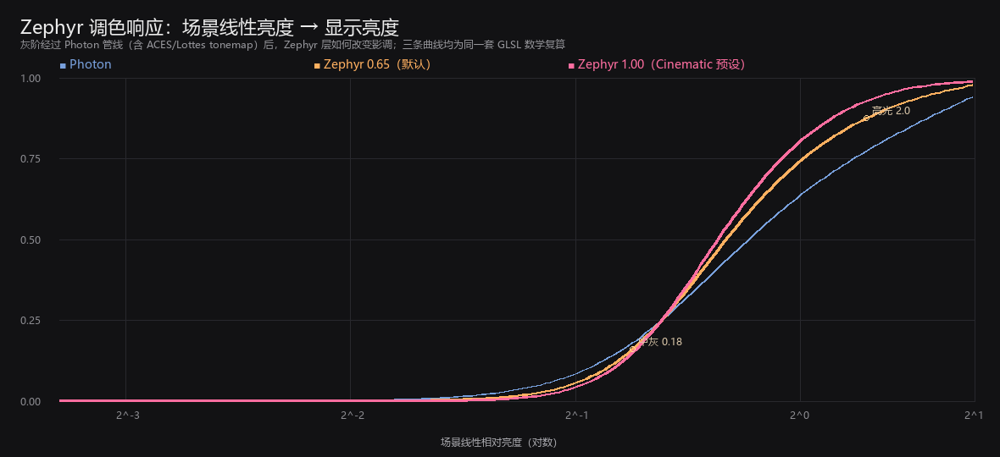
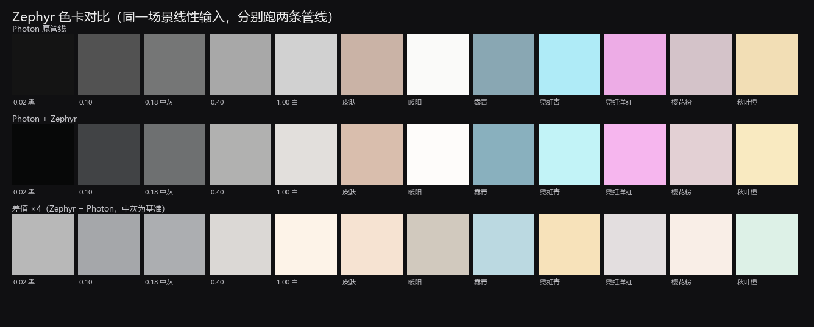

# 参考画面分析（Look Spec）

> 由 `tools/analyze_look.py` 自动生成。目的：把「图里好看的感觉」变成可以调的数值。
> 统计对象是用户给的异环/光追参考截图；数值是成片（已经过游戏自身调色）的统计，不是场景 HDR。

## 1. 参考图统计（逐张）

| 参考图 | 类型 | 亮度 p5 / p50 / p95 | 对比度 | 平均饱和 | 暗部色偏(RGB) | 高光色偏(RGB) |
| --- | --- | --- | --- | --- | --- | --- |
| 秋日逆光·红跑车 | sunset | 0.014 / 0.087 / 0.654 | 0.640 | 0.68 | 1.87 / 0.65 / 0.48 | 1.28 / 0.92 / 0.79 |
| 雾林·红跑车 | fog | 0.027 / 0.163 / 0.572 | 0.544 | 0.33 | 0.90 / 0.85 / 1.26 | 0.95 / 0.93 / 1.11 |
| 沙滩·动漫角色 | anime | 0.008 / 0.238 / 0.584 | 0.576 | 0.39 | 1.48 / 0.86 / 0.66 | 1.14 / 0.94 / 0.92 |
| 雨路·黄昏 | rain | 0.013 / 0.073 / 0.628 | 0.615 | 0.55 | 1.64 / 0.71 / 0.65 | 1.35 / 0.93 / 0.72 |
| 雨林·尾灯 | rain | 0.011 / 0.035 / 0.351 | 0.340 | 0.38 | 1.33 / 0.79 / 0.88 | 1.32 / 0.89 / 0.79 |
| 雨后街道·灰调 | wet | 0.031 / 0.092 / 0.384 | 0.353 | 0.23 | 0.90 / 0.98 / 1.11 | 0.94 / 1.00 / 1.06 |
| 雨后商店街 | wet | 0.015 / 0.066 / 0.320 | 0.304 | 0.35 | 0.76 / 0.95 / 1.29 | 0.94 / 0.99 / 1.07 |
| 夏日乡野·绣球 | day | 0.014 / 0.087 / 0.627 | 0.614 | 0.52 | 0.98 / 1.28 / 0.74 | 0.95 / 1.01 / 1.04 |
| 夜营·暖灯 | night | 0.003 / 0.011 / 0.235 | 0.231 | 0.57 | 0.73 / 1.03 / 1.24 | 1.30 / 1.00 / 0.69 |
| 夜雪·樱花街道 | night | 0.000 / 0.060 / 0.653 | 0.653 | 0.31 | 1.00 / 0.80 / 1.20 | 1.21 / 1.02 / 0.78 |
| 雨夜霓虹·跑车 | neon | 0.007 / 0.026 / 0.374 | 0.367 | 0.55 | 1.52 / 0.83 / 0.65 | 1.37 / 0.95 / 0.67 |
| 桥下·暖阳 | sunset | 0.004 / 0.015 / 0.139 | 0.134 | 0.44 | 1.29 / 0.93 / 0.78 | 1.33 / 0.95 / 0.72 |

## 2. 按类型汇总

| 类型 | 张数 | 平均对比度 | 平均饱和 | 暗部 R/B | 高光 R/B |
| --- | --- | --- | --- | --- | --- |
| anime | 1 | 0.58 | 0.39 | 2.25 | 1.25 |
| day | 1 | 0.61 | 0.52 | 1.32 | 0.92 |
| fog | 1 | 0.54 | 0.33 | 0.71 | 0.85 |
| neon | 1 | 0.37 | 0.55 | 2.36 | 2.04 |
| night | 2 | 0.44 | 0.44 | 0.71 | 1.71 |
| rain | 2 | 0.48 | 0.46 | 1.94 | 1.76 |
| sunset | 2 | 0.39 | 0.56 | 2.52 | 1.73 |
| wet | 2 | 0.33 | 0.29 | 0.69 | 0.88 |

整体：平均对比度（p95−p5）≈ **0.45**，平均饱和度 ≈ **0.44**。

**怎么读这张表：**

- **暗部 R/B**：>1 表示暗部偏暖（红），<1 表示偏冷（青蓝）。参考图里这个值随内容变化：雾天/雨后湿街/夜雪偏冷（≈0.7），夕阳/霓虹/红色车身场景偏暖（1.3~2.5）。
- **高光 R/B**：暖光场景（夕阳/霓虹）≈1.2~2.0，阴雨灰调场景≈0.85~1.1。也就是说：参考图的亮部随光源变暖，但不会无条件偏暖。
- 所以 Zephyr 的分离色调不是「把所有暗部刷青」，而是**高光固定加暖、暗部只轻推一点青**，强度默认 0.55，保留内容本来的色偏。

## 3. 调色响应曲线

三条曲线：Photon 原管线 / Zephyr 默认强度 0.65 / Cinematic 预设强度 1.00。可以看到：

- 中灰（0.18）附近斜率变大 → 中间调对比更强，画面更「立」；
- 高光（2.0）附近曲线更平 → 高光肩部柔和，不容易死白；
- 暗部略有抬升 → `ZEPHYR_BLACK_LIFT` 带来的胶片褪色感。

## 4. 色卡对比

重点看第三行「差值 ×4」：暖色（秋叶橙/暖阳）往暖偏，霓虹青/洋红被轻微去饱和、灰阶被抬了一点黑位——这就是 Zephyr 层在做的事。

## 5. 参数对应关系

| 参考特征 | 数据表现 | Zephyr 参数 |
| --- | --- | --- |
| 高光随光源偏暖 | 高光 R/B ≈ 0.9~2.0 | `highlight_tint`（1.06/1.00/0.93）+ `ZEPHYR_WARMTH` |
| 暗部内容相关 | 雾雨雪偏冷、夕阳霓虹偏暖 | `ZEPHYR_SPLIT_STRENGTH`（默认 0.55，不宜过高） |
| 高对比 | 平均 p95−p5 ≈ 0.45 | `ZEPHYR_FILM_CURVE`、`GRADE_CONTRAST` |
| 饱和度克制 | 平均饱和 ≈ 0.44 | `GRADE_SATURATION`、`ZEPHYR_VIBRANCE` |
| 胶片黑位 | 暗部不纯黑 | `ZEPHYR_BLACK_LIFT` |
| 高光柔和 | 亮部不过曝 | `ZEPHYR_HIGHLIGHT_ROLLOFF`、`BLOOM_INTENSITY` |

> 用法：改完参数后重跑本脚本，看曲线与色卡是否朝目标方向移动；再到游戏里用实机截图确认。
