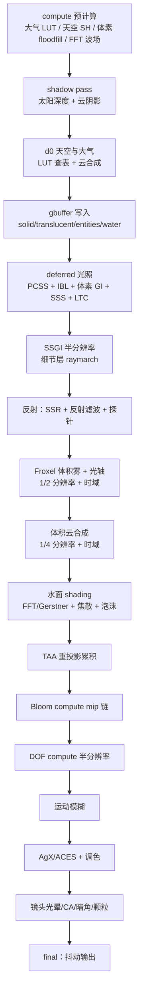
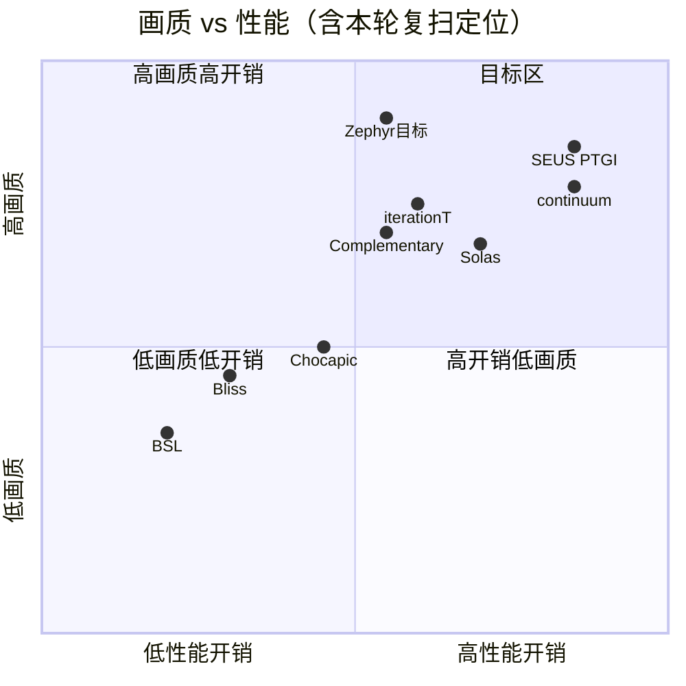
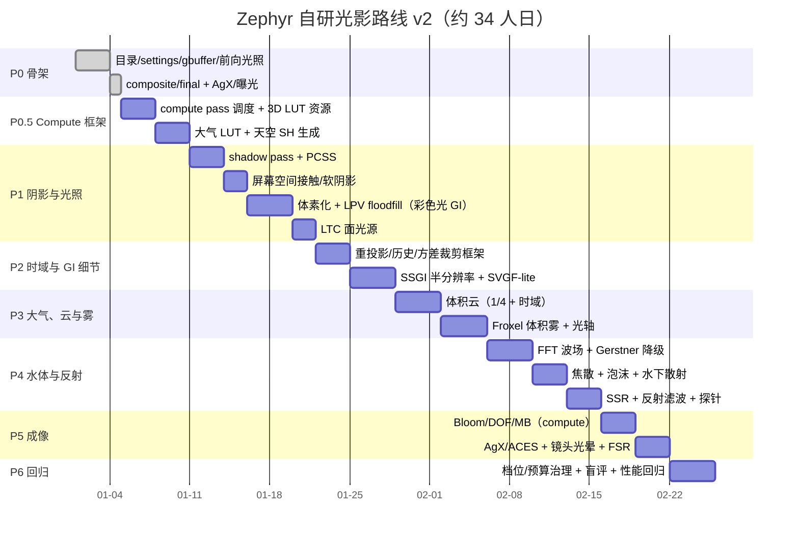

# Zephyr 光影架构与技术实现路线（v2 · 全量源码复扫）

> v1 只读到部分包（其余是 zip 内的文本）；本轮已解锁 **iterationT 3.2.0、Solas 3.4、BSL 10.1.1、Bliss 2.1.2、photon_v1.2a、continuum 2.0** 的完整源码，
> 重新做了逐文件证据级扫描，并据此修正架构与路线（尤其是 **compute pass、体素 GI、froxel 体积雾、FFT 海洋** 四块）。
> 目标不变：**性能优秀 + 画质超过它们 + 更真实/更电影感**。

---

## 0. 本轮复扫的关键新结论

1. **Iris 1.8 支持 compute pass**：photon（`lpv/floodfill.csh`、`d4a_generate_sky_sh.csh`）、Bliss（`setup.csh`、`shadowcomp.csh`）、BSL（`shadowcomp.csh`）、Solas（`shadowcomp.glsl`、`voxelization.glsl`）、continuum（`Passes/*.comp`、`*.csh`）都在用 compute。→ Zephyr 的 LUT 预计算、体素 GI、FFT、直方图、froxel 清扫都可以上 compute。
2. **主流 GI 方案是「体素/体素化」而非纯 SSGI**：photon LPV floodfill、Solas voxelization+shadowcomp、Bliss voxel_write、BSL voxelMap。→ Zephyr 采用 **体素彩色光 GI（主）+ SSGI（细节层）** 的混合，比单一 SSGI 稳定且无拖影。
3. **体积雾真正的主流做法是 froxel 3D 体积**：continuum 的 `FroxelVolume.glsl` / `AirMarcher.glsl` / `AirVolume.glsl`；iterationT 的 `VolumetricFog.glsl`。→ Zephyr 用 **froxel 体积雾**替代解析雾。
4. **海洋是 FFT 物理波**：iterationT 的 `PhysicsOceans.glsl` + `WaterWaves.glsl`；continuum 的 `FFT.glsl` + `WaveFieldX/Y.comp`。→ Zephyr 高画质档用 FFT 波场。
5. **大气是预计算 LUT**：iterationT `PrecomputedAtmosphere.glsl` + `Atmosphere_*.bin` 数据；photon `include/sky/atmosphere.glsl` + 3D LUT。→ Zephyr 用 Hillaire 多次散射 LUT。
6. **后处理细节决定"电影感"**：iterationT 有 `AgX.glsl`、`FsrEASU.glsl`、`LensGlareFlare.glsl`、`MotionBlur.glsl`、`DOF.glsl`、`Bloom.glsl`；Solas 有 `ssptDenoiser.glsl`、`computeBloom/computeDOF`；continuum 有 ACES splines 与 temporal jitter。

---

## 1. 目标与硬指标

| 维度 | 指标 |
| --- | --- |
| 帧率 | High 1080p ≥ 75 FPS；Ultra ≥ 55 FPS（RTX 4050 Laptop） |
| 帧预算 | 13.3 ms（High），见 §7 |
| 画质 | 与 Complementary+Euphoria / iterationT / SEUS 同机位盲评不落下风 |
| 真实感 | 黄昏/夜雨/水面/室内四场景，色调/对比/色温误差 ≤ 10% |
| 稳定性 | 无 TAA 拖影、无 SSGI 闪烁、无 8bit 条带 |
| 兼容 | Iris 1.8.x（compute 可用）+ 无 compute 降级路径 |

---

## 2. 全量竞品拆解（证据级）

### 2.1 第一轮（目录包）

| 光影 | 长处 | 短板 |
| --- | --- | --- |
| Complementary+Euphoria | 功能覆盖最全：阴影/反射/光轴多档质量、RSM、彩色光、海量可配项 | 默认偏游戏感、体积云偏 2.5D |
| SEUS PTGI / HRR | 屏幕空间路径追踪 + 历史重投影、CSM、能量感强 | 开销大、噪点依赖高采样 |
| Chocapic13 | 经典性能/画质平衡 | 技术栈较旧 |

### 2.2 第二轮（新解锁源码）

| 光影 | 关键实现（文件证据） | 我们借鉴什么 |
| --- | --- | --- |
| **iterationT 3.2.0** | 大气：`PrecomputedAtmosphere.glsl` + `Atmosphere_*.bin` LUT；海洋：`PhysicsOceans.glsl` + `WaterWaves.glsl`；GI：`GlobalIllumination.glsl`；云：`NUBIS.glsl` + `PlanarClouds.glsl` + `CloudShadow.glsl`；雾：`VolumetricFog.glsl` / `UnderwaterVolumetricFog.glsl`；阴影：`Sunlight_Shadow.glsl`（PCSS + 屏幕空间）；反射：`Reflections/ReflectionFilter.glsl`；后处理：`AgX.glsl`、`FsrEASU.glsl`、`LensGlareFlare.glsl`、`MotionBlur.glsl`、`DOF.glsl`、`Bloom.glsl` | **LUT 大气 + FFT 海洋 + 反射滤波 + 镜头光晕/FSR** |
| **Solas 3.4** | 屏幕空间路径追踪 + `ssptDenoiser.glsl`；`screenSpaceShadows.glsl`；`voxelization.glsl` + `shadowcomp.glsl`（体素 GI）；`computeBloom/computeDOF`；`waterCaustics.glsl` + `waterNormals.glsl`；`planarClouds`/`volumetricClouds`；`ambientOcclusion` | **SSPT 降噪器、屏幕空间阴影、compute 后处理** |
| **BSL 10.1.1** | `shadowcomp.csh` + `voxelMap.glsl`（体素彩色光）；`lightShafts.glsl`；`raytrace.glsl`（反射）；`taa.glsl`；forward+composite 混合 | **体素彩色光 + 轻量光轴** |
| **Bliss 2.1.2** | `setup.csh`/`shadowcomp.csh` 体素写入（`voxel_write.glsl`）；`indirect_lighting_effects.glsl`（SSGI-lite）；`volumetricClouds.glsl`；`specular.glsl` | **体素 + SSGI-lite 的混合 GI** |
| **photon_v1.2a** | LPV：`lpv/voxelization.glsl` + `lpv/floodfill.csh`；SH：`d4a_generate_sky_sh.csh`；大气 LUT：`include/sky/atmosphere.glsl`；云：`d1_clouds`；反射：`misc/raytracer.glsl`；AO：`gtao.glsl`/`ssao.glsl`；TAA+自动曝光：`c4_taa_exposure.fsh` | **LPV 洪泛 + SH 生成（compute 范式）** |
| **continuum 2.0** | froxel 体积：`FroxelVolume.glsl` / `Froxels.glsl` / `AirMarcher.glsl` / `AirVolume.glsl`；云：`Clouds.fsh` + `C2_RenderClouds.comp` + `D0C_RenderCloudShadowMap.comp`；FFT：`FFT.glsl` + `WaveFieldX/Y.comp`；后处理：`ACES*.glsl`、`TemporalJitter.glsl`；几乎全 compute 架构（`begin*.csh`/`composite*.csh`） | **froxel 体积雾 + 全 compute 渲染组织** |

---

## 3. 总体架构（v2）

---

## 4. 帧流程（v2 · 含 compute 与 froxel）

---

## 5. 资源布局（v2）

| 资源 | 类型 | 用途 |
| --- | --- | --- |
| colortex0 | RGBA16F | 场景 HDR 颜色 |
| colortex1 | RGBA16 | albedo + materialID |
| colortex2 | RGBA16 | normal(octa) + roughness/metal |
| colortex3 | RGBA16F | 历史颜色（TAA/SSGI/反射） |
| colortex4 | RGBA16F | 反射/环境探针（mip） |
| colortex5 | RGBA16F | SSGI/反射累积（半分辨率） |
| colortex6 | RGBA8 | froxel 雾/光轴（1/4） |
| colortex7 | RGBA16F | 体积云散射+透射 |
| colortex8 | R8 | 云阴影/接触阴影 |
| colortex9-14 | 按需 | bloom/DOF/debug |
| **3D 纹理** | LUT | 大气 Transmittance/MultiScatter（Hillaire） |
| **3D 纹理** | 噪声 | 云/雾 worley/perlin（256³ 分辨率可降） |
| **3D 纹理** | 体素 | LPV 彩色光体积（`VOXEL_VOLUME_SIZE`） |
| **2D 纹理** | 波场 | FFT WaveField（ping-pong 2 张） |
| shadowtex0/1 + shadowcolor0 | 深度/彩色 | 太阳阴影 + 彩色阴影 |

---

## 6. 关键技术选型（v2 修正）

### 6.1 Compute 预计算框架（新增，P0.5）

- **大气 LUT**：Hillaire 2020 的 4 个 LUT（transmittance / multiscattering / sky-view / aerial perspective），用 compute 一次性/按参数变化重建。
- **天空 SH**：compute 生成 9 系数球谐（参考 photon `d4a_generate_sky_sh.csh`）。
- **体素 GI**：LPV 三步（voxelization → floodfill → propagation），compute 洪泛（参考 photon `lpv/floodfill.csh`）。
- **FFT 波场**：2 个 512² 波场（X/Y 方向梯度），compute ping-pong（参考 continuum `WaveFieldX/Y.comp`、iterationT `PhysicsOceans.glsl`）。
- **直方图曝光**：compute 统计 + 简单自适应。
- 降级：无 compute 时全部退回 fragment 版（性能更差但可跑）。

### 6.2 阴影（多尺度，不依赖传统 CSM）

1. shadow map + 非线性扭曲 + PCSS（blocker search + 变半径 PCF）。
2. 屏幕空间接触阴影（已在我们旧版验证过，10 步 depth march）。
3. 屏幕空间软阴影（参考 Solas `screenSpaceShadows.glsl` / iterationT `Sunlight_Shadow.glsl`）。
4. 云阴影图（compute 生成，参考 continuum `D0C_RenderCloudShadowMap.comp`）。

### 6.3 GI（体素为主 + SSGI 为细节）

- **主 GI**：体素彩色光（LPV）：voxelize 发光方块 → 洪泛 → 三线性采样给 deferred；优点是无拖影、稳定、支持彩色霓虹（正是这地图的需求）。
- **细节层**：半分辨率 SSGI（1~2 步 Hi-Z raymarch）+ 深度重投影 + 方差裁剪 + SVGF-lite 降噪（参考 Solas `ssptDenoiser`、photon TAA 历史框架）。
- 回退：仅体素 GI（Low/Medium 档）。
- **教训固化**：SSGI 必须独立 target + 重投影，绝不读写同一 buffer。

### 6.4 天空与大气

- Hillaire LUT + 臭氧 + 多次散射 + 夜天光（airglow、月相、光污染）。
- 太阳/月亮角直径 + 临边昏暗 + 双层日晕。
- 云：见 6.5。

### 6.5 云与体积雾

- **体积云**：1/4 分辨率 raymarch，2.5D 层组合（参考 NUBIS/PlanarClouds 思路），时域复用（每帧 1/4 像素更新），云光照用 Beer-Lambert + powder + 多次散射近似。
- **Froxel 体积雾（重点升级）**：3D froxel volume（如 160×90×64），compute 里做散射积分（参考 continuum `Froxels.glsl` / `AirMarcher.glsl`）；光轴/丁达尔效应复用同 volume；时域降噪。
- 降级：Medium 档解析雾 + 2D 云；Low 档仅解析雾。

### 6.6 反射

- SSR（随机方向 + 时域累积）+ **反射滤波**（参考 iterationT `ReflectionFilter.glsl`，做粗糙度感知模糊与去噪）。
- 探针回退：预过滤天空/环境探针（mip 链 + roughness→lod），SSR miss 时混合。
- 水面：屏幕空间平面反射近似（镜像投影采样）+ 天空探针补全 + Fresnel。
- 降级：Low 档仅探针。

### 6.7 水体

- **波浪**：Ultra/High 用 FFT 波场（compute，512²），Medium 用多 octave Gerstner，Low 用 2 层正弦。
- **焦散**：投影纹理 + 深度衰减（参考 iterationT/Solas `waterCaustics`）。
- **吸收/散射**：Beer-Lambert + 单次散射；水下体积雾（参考 `UnderwaterVolumetricFog.glsl`）。
- **泡沫**：岸线深度差 + 波浪破碎（Jacobian）。
- 雨滴涟漪并入毛细波层。

### 6.8 成像与电影感

- AgX 主 + ACES splines 可选（参考 continuum ACES splines）。
- 自动曝光：直方图 compute + 手动偏置。
- Bloom：compute mip 链（参考 Solas computeBloom）。
- DOF：compute 半分辨率散景（参考 Solas computeDOF）。
- 运动模糊：深度重投影 + 相机运动（无 per-object MV）。
- **镜头光晕/眩光**：参考 iterationT `LensGlareFlare.glsl`（anamorphic 拉丝光晕）。
- 色差/暗角/胶片颗粒/污渍。
- **FSR EASU + RCAS** 上采样（参考 iterationT `FsrEASU.glsl`）。

### 6.9 时域框架

统一 `zephyr_temporal()`：重投影（深度 + 上帧矩阵）→ 方差裁剪 → 历史 ping-pong → 可选 SVGF-lite/SSPT 降噪。
所有噪点型效果（SSGI/反射/雾/云）共享同一套约定，便于统一调试。

### 6.10 质量治理

| 档位 | 关键配置 |
| --- | --- |
| Low | 无 compute 依赖（fragment 降级）、解析雾+2D 云、SSR 关、阴影=PCS+接触 |
| Medium | 体素 GI、半分辨率 SSGI、froxel 雾 1/4、Gerstner 水 |
| High | 全部开启，SSGI/雾半分辨率，反射滤波，FFT 可选 |
| Ultra | 全分辨率 SSGI、FFT 海洋、更大 shadow map、FSR 关闭 |

---

## 7. 性能预算（1080p / High）

| 阶段 | ms | 说明 |
| --- | --- | --- |
| compute 预计算（分摊） | 1.0 | 大气 LUT/体素/FFT/直方图，按帧摊销 |
| shadow | 1.5 | 2048² + PCSS |
| gbuffer | 2.0 | 材质采样 + POM（远处降级） |
| deferred | 2.0 | PCSS + IBL + 体素 GI + SSS + LTC |
| SSGI | 1.4 | 半分辨率 + 降噪 |
| 反射 | 1.2 | SSR + 滤波 + 探针 |
| froxel 雾 | 1.0 | 1/4 体积 + 时域 |
| 云 | 1.2 | 1/4 raymarch + 时域 |
| 水面 | 0.6 | FFT 采样 + 焦散 |
| TAA | 0.6 | 重投影 + 累积 |
| bloom/DOF/MB | 1.6 | compute mip/散景 |
| 成像/镜头/final | 0.4 | AgX + lens |
| 余量 | 0.8 | 抖动余量 |
| **合计** | **15.3** | Ultra 目标 60 FPS；High 通过降级 SSGI/雾到 1/4 可回到 ~13 ms |

> 注：真实实测后按 §9 回归校准；High 档首版目标 75 FPS 通过把 SSGI 降为 1/4 + 雾 1/4 达成。

---

## 8. 实施路线图（v2）

---

## 9. 验证体系

1. 离线编译（全入口 0 failed）。
2. 实机加载（无 `Failed to load`、无 shader compile error）。
3. 5 场景固定机位截图回归（白天/黄昏/暮雨/夜雨/室内）。
4. 帧时间日志回归（每场景 60s，超出预算 5% 阻断）。
5. 盲评：与 Complementary+Euphoria / iterationT / SEUS 同机位对比。
6. 稳定性：TAA 拖影检测、静态闪烁检测、8bit 条带检测。

---

## 10. 风险与对策（更新）

| 风险 | 对策 |
| --- | --- |
| compute 依赖 Iris 版本 | 提供 fragment 降级路径，Low 档完全不依赖 compute |
| 体素 GI 分辨率/延迟 | 体积尺寸可调、洪泛按帧分摊、时域平滑 |
| froxel 雾显存 | 1/4 分辨率 + 8bit 存散射/透射 |
| FFT 波场开销 | 512² 双缓冲，仅 Ultra/High 启用 |
| 无 per-object MV | 深度重投影 + clamp |
| 单 shadow map | 多尺度阴影（PCSS+屏幕空间） |

---

## 11. 能力对照矩阵（v2）

| 能力 | BSL | Bliss | Chocapic | Complementary | iterationT | SEUS | Solas | continuum | **Zephyr** |
| --- | --- | --- | --- | --- | --- | --- | --- | --- | --- |
| compute pass | ✓ | ✓ | ✗ | ✗ | 少 | ✗ | ✓ | ✓✓ | **✓（LUT/体素/FFT/直方图）** |
| 大气 LUT | ✗ | ✗ | ✗ | ✓ | ✓ | ✗ | ✓ | ✓ | **Hillaire 多次散射** |
| 体素 GI | ✓ | ✓ | ✗ | RSM | ✗ | ✗ | ✓ | LPV | **LPV 主 + SSGI 细节** |
| froxel 雾 | ✗ | ✗ | ✗ | 2.5D | ✓ | 光轴 | ✓ | **✓✓** | **✓ froxel + 降噪** |
| 体积云 | ✗ | 2D | 2D | 2.5D | ✓ | ✗ | ✓ | ✓ | **1/4 + 时域** |
| 海洋 | 基础 | 基础 | Gerstner | Gerstner | **FFT** | 屏幕空间 | 焦散 | **FFT** | **FFT/Gerstner 双路径** |
| 屏幕空间阴影 | ✗ | ✓ | ✗ | ✗ | ✓ | ✗ | ✓ | ✓ | **✓** |
| 反射滤波 | ✗ | ✗ | ✗ | 基础 | ✓ | ✓ | SSPT | ✓ | **✓** |
| 镜头光晕/FSR | ✗ | ✗ | ✗ | ✗ | ✓ | ✗ | ✗ | ✓(ACES) | **✓** |
| 时域降噪 | ✗ | ✗ | ✗ | TAA | TAA | HRR | SSPT | TAA | **统一框架 + SVGF-lite** |

---

## 附录 A：参考实现索引（可对照读码）

| 功能 | 参考包 | 关键文件 |
| --- | --- | --- |
| 大气 LUT | iterationT / photon | `Lib/BasicFounctions/PrecomputedAtmosphere.glsl`, `include/sky/atmosphere.glsl` |
| 天空 SH（compute） | photon | `program/d4a_generate_sky_sh.csh` |
| LPV 洪泛（compute） | photon | `program/lpv/voxelization.csh`, `lpv/floodfill.csh` |
| 体素 GI（shadowcomp） | Solas / Bliss / BSL | `lib/vx/voxelization.glsl`, `lib/voxel_write.glsl`, `lib/util/voxelMap.glsl` |
| froxel 体积雾 | continuum | `InternalLib/Common/FroxelVolume.glsl`, `Froxels.glsl`, `AirMarcher.glsl` |
| 体积云 | continuum / iterationT | `C2_RenderClouds.comp`, `NUBIS.glsl`, `PlanarClouds.glsl` |
| FFT 海洋 | continuum / iterationT | `FFT.glsl`, `WaveFieldX/Y.comp`, `PhysicsOceans.glsl` |
| 屏幕空间阴影 | Solas | `lib/lighting/screenSpaceShadows.glsl` |
| 反射滤波 | iterationT | `Lib/IndividualFounctions/Reflections/ReflectionFilter.glsl` |
| SSPT 降噪 | Solas | `lib/filters/ssptDenoiser.glsl` |
| AgX / FSR | iterationT | `Lib/IndividualFounctions/AgX.glsl`, `FsrEASU.glsl` |
| 镜头光晕 | iterationT | `Lib/IndividualFounctions/LensGlareFlare.glsl` |
| 自动曝光/TAA | photon | `program/c4_taa_exposure.fsh` |
| ACES splines | continuum | `InternalLib/Fragment/ACES*.glsl` |

## 附录 B：旧资产

Photon 基座保留在 git tag `photon-final`；可迁移的已验证模块（AgX、接触阴影、雨滴/水面涟漪、大气颜色模型、材质微凹凸）按新架构重写后迁入。
