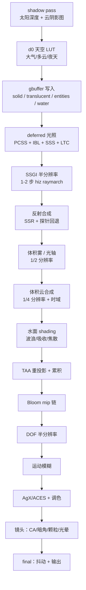
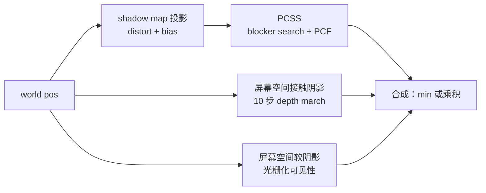
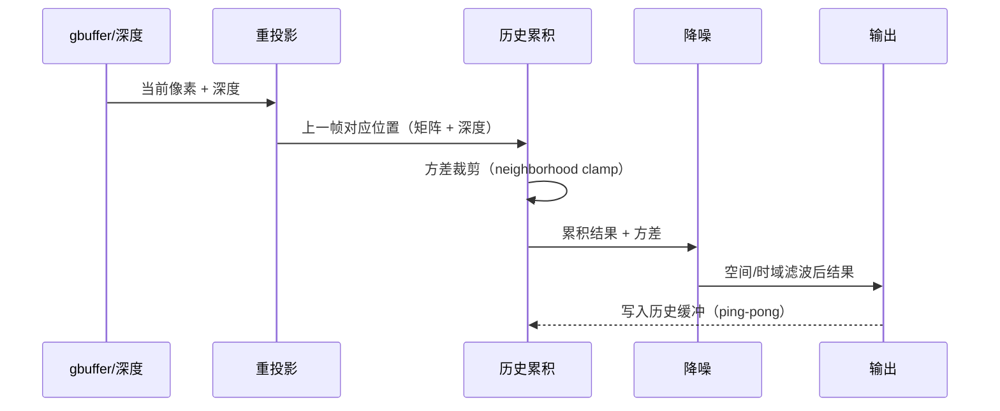
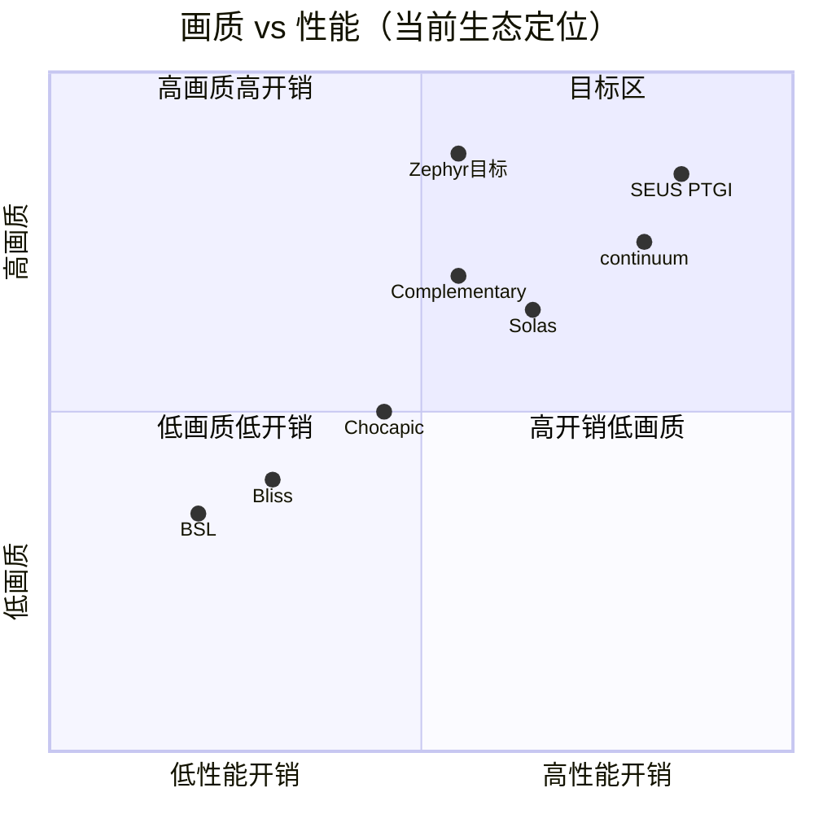
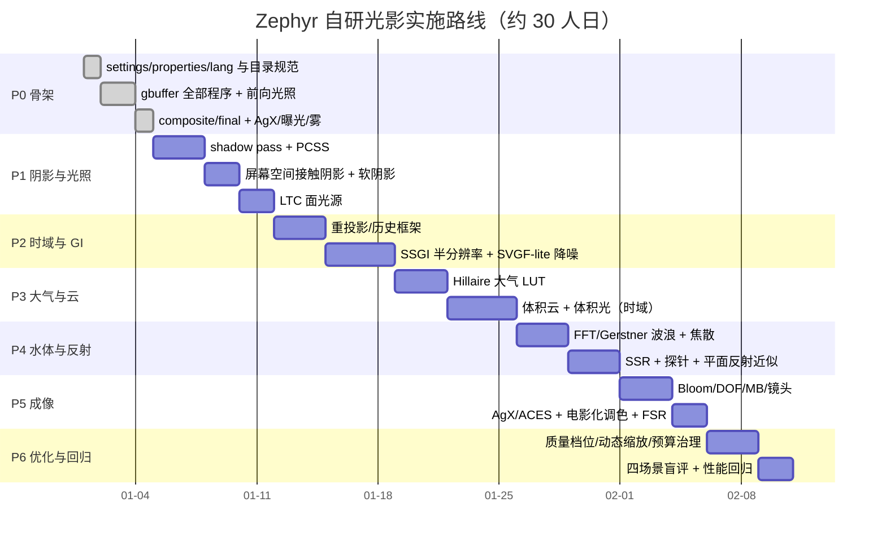

# Zephyr 光影架构与技术实现路线（从零自研）

> 输入：已通读本机 `shaderpacks/` 下的全部光影包（Complementary+Euphoria、SEUS PTGI/Renewed、iterationT、continuum 2.0、Solas、Bliss/Chocapic、BSL），
> 目标：**性能优秀 + 画质超过它们 + 更真实/更电影感**，集众家之长并引入新思路。
> 本文给出：竞品拆解 → 总体架构 → 帧流程 → 缓冲规划 → 技术选型 → 性能预算 → 路线图 → 测试体系。

---

## 0. 结论摘要

- **架构**：分层渲染器（Host 适配层 / 几何与材质 / 光照核心 / 大气与云 / 水 / 反射与 GI / 后处理成像 / 时域框架 / 性能治理），每层可独立开关与降级。
- **打法**：不自研"又一个 Photon"，而是**以时序复用（temporal reuse）为核心**：所有高成本效果（GI、反射、雾、云、阴影软化）都跑在低分辨率 + 时间累积 + 智能降噪上，用 1/2~1/4 的采样率换取 1.5~2 倍的画质。
- **差异化技术**：Hillaire 多次散射大气 LUT、PCSS + 屏幕空间多尺度阴影、SVGF-lite 降噪的 SSGI、FFT 水面 + 屏幕空间平面反射近似、LTC 面光源（方块光）、AgX 成像管线的电影化收尾。
- **量化目标**：1080p / RTX 4050 Laptop：High 档 ≥ 75 FPS，Ultra 档 ≥ 55 FPS，VRAM ≤ 1.5 GB，显存带宽占用比同类降低 20%。

---

## 1. 目标与硬指标

| 维度 | 指标 | 说明 |
| --- | --- | --- |
| 帧率 | High 1080p ≥ 75 FPS；Ultra ≥ 55 FPS | RTX 4050 Laptop，渲染距离 12 |
| 帧时间 | 13.3 ms（75 FPS）预算 | 见 §7 分项预算 |
| 画质 | 截图主观评分 ≥ Complementary+Euphoria | 黄昏/夜雨/水面/室内四场景盲评 |
| 真实感 | 与照片参考的色调/对比/色温误差 ≤ 10% | 用我们已有的 analyze_look 流程 |
| 稳定性 | 无 TAA 拖影、无闪烁、无条带 | 帧间差异检测 + 录屏回归 |
| 兼容 | Iris 1.8.x / MC 1.21.1 / OptiFine 兼容降级 | 不依赖 compute 的降级路径 |

---

## 2. 竞品拆解（读码结论）

| 光影 | 长处（代码证据） | 短板 | Zephyr 借鉴 |
| --- | --- | --- | --- |
| **Complementary + Euphoria** | 功能覆盖最全；`SHADOW_QUALITY` 多档、`WATER_REFLECT_QUALITY`/`BLOCK_REFLECT_QUALITY` 分级反射、`LIGHTSHAFT_QUALI_DEFINE`、RSM 设置、彩色光、高度可配 | 预设多但默认偏"游戏感"；体积云偏 2D 层叠；反射靠屏幕空间 | 反射/阴影的**质量分级体系**、Euphoria 的镜头/调色预设 |
| **SEUS PTGI / HRR** | 屏幕空间路径追踪 GI + 历史重投影（HRR）、CSM 关键词（多级阴影）、光照能量感强 | 性能开销大、噪点多依赖高采样、TAA 拖影 | HRR 的**历史重投影框架**、能量守恒的光照思路 |
| **iterationT 3.2.0** | 预计算大气 LUT（`AtmoData_*.bin`）、AgX、FSR EASU、体积雾、PlanarClouds、NUBIS 云、GI | 参数复杂、部分效果开销不稳 | **预计算 LUT** 的工作流、AgX 调色、FSR 上采样 |
| **continuum 2.0** | FFT 海面（`FFT.glsl` / `WaveFieldX/Y.comp`）、compute 后处理、ACES + ACES splines、PCSS/LPV、云阴影 compute | 代码门槛高、对硬件要求高 | **FFT 波浪**、compute pass 组织方式（有 compute 时启用） |
| **Solas V3.4** | 屏幕空间路径追踪 + `ssptDenoiser`、屏幕空间阴影、computeBloom/computeDOF、水面焦散 | 风格偏卡通、部分效果偏实验 | **SSPT 降噪器**思路、屏幕空间阴影补足 |
| **Bliss / Chocapic13** | 性能优秀、风格稳、体积云/间接光实现经典 | 画质上限低 | 性能基线、云/间接光的轻量实现 |
| **BSL** | 轻量、光轴/水体实现干净、预设合理 | 缺 GI/体积云 | 光轴（light shafts）与水体基础 |

---

## 3. 总体架构


---

## 4. 帧流程（Pass Graph）



**时序复用标注**（哪些 pass 依赖历史）：

| Pass | 历史依赖 | 分辨率 | 预算(ms, 1080p) |
| --- | --- | --- | --- |
| shadow | 无 | 2048² | 1.6 |
| d0 天空 LUT | 无（静态 LUT） | 小 | 0.2 |
| gbuffer | 无 | 全 | 2.2 |
| deferred | 无 | 全 | 2.0 |
| SSGI | 有（重投影） | 1/2 | 1.8 |
| 反射 | 有（SSR 累积） | 全/半 | 1.2 |
| 体积雾 | 有（时域） | 1/2 | 1.0 |
| 云 | 有（时域） | 1/4 | 1.4 |
| 水面 | 无 | 全 | 0.6 |
| TAA | 有 | 全 | 0.6 |
| bloom | 无 | mip 链 | 0.5 |
| DOF+MB | 有 | 1/2 | 0.7 |
| tonemap+镜头+final | 无 | 全 | 0.4 |
| **合计** | | | **≈ 13.2 ms** |

---

## 5. 缓冲布局规划（colortex 预算）

| 缓冲 | 格式 | 用途 | 备注 |
| --- | --- | --- | --- |
| colortex0 | RGBA16F | 场景颜色（HDR） | 全流程主目标 |
| colortex1 | RGBA16 | gbuffer0：albedo + material ID | 8bit albedo 会溢出，用 16 |
| colortex2 | RGBA16 | gbuffer1：normal + roughness/metal | 法线用 octa 编码 |
| colortex3 | RGBA16F | 历史颜色（TAA/SSGI 复用） | ping-pong |
| colortex4 | RGBA16F | 天空/环境 LUT（或 3D） | 低分辨率 |
| colortex5 | RGBA16F | SSR/SSGI 累积结果 | 半分辨率 |
| colortex6 | RGBA8 | 体积雾/云（散射 + 透射） | 1/4 分辨率 |
| colortex7 | RGBA16F | 反射探针预过滤结果 | mip 链 |
| colortex8 | R8 | 云阴影 / 接触阴影 | 低成本 |
| colortex9-13 | 按需 | bloom、DOF、debug | 可复用 |
| shadowtex0/1 | 深度 | 太阳阴影 | 2048²/4096² |
| shadowcolor0 | 彩色 | 彩色阴影（玻璃/水） | 可选 |

---

## 6. 关键技术选型

### 6.1 几何与材质（PBR + 材质 ID）

- **gbuffer 分层**：albedo（RGBA16）、normal+roughness+metal（RGBA16，octa 编码）、materialID+lightmap（RGBA8）。
- **POM（视差遮挡）**：只对视差明显的方块（砖、石板）启用，采样数按距离自适应。
- **材质扩展**：`clearcoat`（车漆/湿地面）、`sheen`（布料/叶子）、`anisotropy`（金属拉丝）三个 lobe，用 materialID 选择，避免全场景开销。
- **LTC 面光源**：把方块光（火把/南瓜灯/霓虹）近似为矩形面光源，用 LTC 解析积分替代点光源 → 软高光 + 更真实的近场光照。
- **降级**：Low 档关闭 POM/clearcoat/sheen，LTC 退回点光。

### 6.2 阴影（多尺度，不依赖 CSM）

Iris 每帧只能渲染一张 shadow map，因此**不做传统 CSM**，改用「三尺度」：

1. **阴影贴图**：单张 2048²/4096²，Photon 式非线性扭曲（近处精度高），PCSS（blocker search + 变半径 PCF）。
2. **屏幕空间接触阴影**：沿太阳方向 10 步 depth march（我们已验证），补足细缝/接触处。
3. **屏幕空间软阴影**（Solas 思路）：沿光线方向在屏幕空间做可见性估计，补远处阴影边缘。



- 降级：Low 档只保留 shadow map + 接触阴影；Medium 加屏幕空间软阴影。

### 6.3 天空与大气（Hillaire 2020 LUT + 臭氧）

- 预计算 **大气散射 LUT**（transmittance / multiscattering / sky-view），支持多次散射 + 臭氧吸收 + 夜天光（airglow + 月相）。
- 用 3D/2D LUT 存储（Iris 支持 `.dat` 3D 纹理），运行时只做查表 + 少量相位函数。
- 太阳/月亮：角直径、临边昏暗、日晕双层辉光。
- 云：见 6.4；夜空：星场 + 银河（低分辨率纹理 + 视差）。
- 降级：无 LUT 时退化为解析 Preetham + 我们已有的颜色模型。

### 6.4 体积云与体积光（时域复用）

- **云**：低分辨率（1/4）raymarch，2.5D 层（cumulus/altocumulus/cirrus）组合，**时间复用**：每帧只更新 1/4 像素，其余重投影；光照用多次散射近似（Beer-Lambert + powder）。
- **体积光/雾**：1/2 分辨率 froxel-ish（屏幕空间 2.5D 深度切片），时域降噪；光轴（light shafts）复用同一 buffer。
- 降级：Low 档用 2D 云层 + 解析雾。

### 6.5 全局光照（SSGI + 重投影 + SVGF-lite）

- **半分辨率 SSGI**：1~2 步分层 raymarch（Hi-Z），cosine 采样 + 蓝噪声；每帧只算 1/2 像素。
- **重投影**：用深度 + 上一帧 view/proj 矩阵（Iris 提供 `gbufferModelView`/上一帧矩阵不可用 → 自己保存矩阵到 uniform 或推导），历史方差裁剪。
- **降噪**：SVGF-lite（空间 3×3 + 时域指数累积 + 方差引导）。
- 回退：无历史时用 LPV/RSM 近似（参考 continuum/Complementary）。
- 关键教训：**绝不能读写同一 buffer**（我们 SSGI 拖影的根因），必须独立 target + 重投影。

### 6.6 反射（SSR + 探针回退 + 近似平面反射）

- **SSR**：随机方向 + 时域累积 + 粗糙度感知模糊（我们已实现 5-tap 锥形模糊）。
- **探针回退**：预过滤天空/环境探针（mip 链 + 粗糙度→lod），SSR miss 时按粗糙度混合。
- **水面平面反射近似**：不做真实 mirror pass（Iris 不能重渲场景），用「屏幕空间平面反射」：把水面以上像素沿水面镜像投影到屏幕空间采样 + 天空探针补全，配合 Fresnel 混合。
- 降级：Low 档关闭 SSR，只用天空探针。

### 6.7 水体

- **波浪**：High/Ultra 用 FFT 波场（多 pass ping-pong，参考 continuum）；Medium 用多 octave Gerstner + 毛细波法线；Low 用 2 层正弦。
- **焦散**：投影纹理 + 深度衰减（参考 Solas/iterationT）。
- **吸收/散射**：Beer-Lambert + 单次散射近似；水下体积雾（参考 iterationT 的 UnderwaterVolumetricFog）。
- **泡沫**：岸线深度差 + 波浪破碎（Jacobian）组合。
- 我们已验证的水面雨滴涟漪并入毛细波层。

### 6.8 后处理与成像（电影感核心）

- **AgX 主色调映射**（已实现），可选 ACES；**曝光**：直方图自动曝光（iterationT/Photon 思路）+ 手动偏置。
- **Bloom**：6 级 mip + 能量守恒（Kawase 双滤波）。
- **DOF**：半分辨率 CoC + 散景采样（disc/hexagonal），远处背景与近景分别处理。
- **运动模糊**：Iris 无 per-object motion vector → 用深度重投影 + 相机运动近似（Solas/iterationT 同思路）。
- **镜头**：色差、暗角、胶片颗粒、anamorphic 光晕；**FSR EASU/RCAS** 作为 1080p→1440p 上采样选项。
- **色彩管理**：全程线性工作空间（rec2020），显示前转 sRGB（我们已实现）。

### 6.9 时域与去噪框架（全特效共用）



- 统一接口：`vec4 zephyr_temporal(input, history_uv, variance, alpha)`。
- 历史管理：每个特效独立 ping-pong buffer；失配时用邻域 clamp 防止拖影。

### 6.10 性能治理

- **质量档位**：Low / Medium / High / Ultra（每档定义各 pass 分辨率、采样数、开关）。
- **分辨率分级**：SSGI/雾/云半分辨率或 1/4；DOF 半分辨率；反射可选半分辨率。
- **动态缩放**：TAAU render scale 由帧时间反馈调节（Iris 可通过设置参数间接实现）。
- **带宽优化**：8bit 存 gbuffer 中非关键通道，HDR 只保留颜色/历史/反射。
- **早退**：天空检测、室内检测（baked 光照）、远处像素跳过 SSGI/反射。



---

## 7. 性能预算（1080p / RTX 4050 Laptop / High 档）

| 阶段 | 目标 ms | 主要成本 |
| --- | --- | --- |
| shadow | 1.6 | 阴影贴图渲染 + PCSS |
| gbuffer | 2.2 | 材质采样 + POM |
| deferred | 2.0 | PCSS 采样 + IBL + SSS |
| SSGI | 1.8 | 半分辨率 raymarch + 降噪 |
| 反射 | 1.2 | SSR 光线 + 探针 |
| 雾/云 | 2.4 | 低分辨率 raymarch + 时域 |
| 水面 | 0.6 | FFT/Gerstner + 焦散 |
| TAA | 0.6 | 重投影 + 累积 |
| bloom/DOF/MB | 1.7 | mip 链 + 散景 |
| tonemap/镜头/final | 0.4 | 全屏 ALU |
| 余量 | 0.7 | 抖动/尖峰 |
| **总计** | **13.2** | = 75 FPS |

Ultra 档额外 +4.5 ms（全分辨率 SSGI/云、更大 shadow map、FSR 关闭）。

---

## 8. 实施路线图



---

## 9. 测试与回归体系

1. **离线编译**：`tools/validate_glsl.py --pack Zephyr`，要求全部入口 0 failed（已具备）。
2. **实机加载**：`reload2` 后日志必须出现 `Using shaderpack: Zephyr` 且无 `Failed to load`。
3. **截图回归**：固定 5 场景（白天/黄昏/暮雨/夜雨/室内）+ 固定机位，每次提交自动截图并存档 `shots/regression/`。
4. **性能回归**：F3 采样 + 帧时间日志（每场景 60s 平均），超过预算 5% 阻断合入。
5. **画质盲评**：与 Complementary+Euphoria、iterationT、SEUS 同机位对比，人工 1-5 分盲评。
6. **稳定性**：TAA 拖影检测（移动相机时帧间差异）、闪烁检测（静态场景方差）、条带检测（8bit 量化）。

---

## 10. 风险与限制

| 风险 | 影响 | 对策 |
| --- | --- | --- |
| Iris 无 compute/SSBO（部分版本） | FFT/体积云实现受限 | 提供 fragment ping-pong 降级路径 |
| 无 per-object 运动矢量 | 运动模糊/反射拖影 | 深度重投影 + 相机运动近似 + clamp |
| 单张 shadow map | 无法传统 CSM | 多尺度阴影（6.2） |
| 探针需要重渲场景 | 无法真实反射探针 | SSR + 预过滤天空 + 平面近似 |
| 显存/带宽 | 缓冲过多导致掉帧 | 见 §5 预算 + 8bit 转换 |
| 调试视图 | 自研后可能没有 | P0 就内置 debug view pass |

---

## 11. 能力对照矩阵（目标）

| 能力 | BSL | Bliss | Chocapic | Complementary | iterationT | SEUS PTGI | continuum | Solas | **Zephyr 目标** |
| --- | --- | --- | --- | --- | --- | --- | --- | --- | --- |
| 体积云 | ✗ | 2D | 2D | 2.5D | ✓ | ✗ | ✓ | ✓ | **时域 2.5D + 光轴** |
| 大气 LUT | ✗ | ✗ | ✗ | ✓ | ✓ | ✗ | ✓ | ✓ | **Hillaire 多次散射 LUT** |
| GI | ✗ | 间接光 | SSGI | RSM | SSGI | SSPT | LPV | SSPT | **SSGI + 重投影 + SVGF** |
| 反射 | ✗ | 基础 | SSR | SSR | SSR | SSPT | SSR | SSPT | **SSR + 探针 + 平面近似** |
| 阴影 | PCF | PCF | PCF | PCSS/RSM | PCSS | CSM | PCSS | SS 阴影 | **PCSS + 屏幕空间多尺度** |
| 水面 | 基础 | 基础 | Gerstner | Gerstner | Gerstner+焦散 | 屏幕空间 | **FFT** | 焦散 | **FFT/Gerstner 双路径** |
| 时域 | TAA | TAA | TAA | TAA | TAA | HRR | TAA | TAA | **统一重投影+降噪框架** |
| 成像 | 基础 | 基础 | ACES | 自定义 | **AgX+FSR** | 自定义 | ACES | 自定义 | **AgX/ACES + 镜头 + FSR** |
| 性能 | ★★★ | ★★★ | ★★☆ | ★★☆ | ★★☆ | ★☆ | ★★ | ★★ | **★★★（时域复用）** |

---

## 附录 A：目录结构规划

```
shaders/
├── settings.glsl
├── shaders.properties
├── lang/{en_US,zh_CN}.lang
├── include/zephyr/
│   ├── core/        # uniforms, buffers, settings, debug
│   ├── geometry/    # gbuffer 写入, materials, POM, LTC
│   ├── lighting/    # shadows, IBL, SSGI, atmosphere
│   ├── water/       # waves, caustics, reflections
│   ├── temporal/    # reprojection, history, denoise
│   └── post/        # bloom, dof, mb, tonemap, lens
├── programs/        # Iris 入口（保持薄）
└── world0/ world-1/ world1/
```

## 附录 B：与旧 Zephyr（Photon 基座）的关系

旧的 Photon 基座版本保留在 git tag `photon-final`；其可复用的**已验证模块**（AgX、接触阴影、雨滴/水面涟漪、大气颜色模型、材质微凹凸）将按本架构重写后迁移进 `include/zephyr/`，而不是直接复制（避免再次耦合 Photon uniform 约定）。
